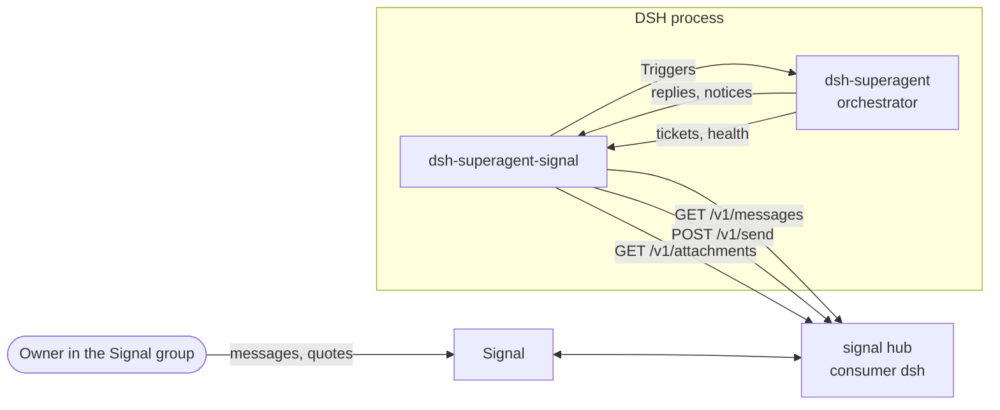

# Architecture

dsh-superagent-signal is a cordis plugin for DSH. It registers one Source kind, `signal`, with dsh-superagent and runs two loops against the signal hub: intake and notices. It holds no database of its own: all state goes through the Source context dsh-superagent provides.

## Context

## Components

| File | Role |
| --- | --- |
| `src/index.ts` | Plugin entry. Builds one `HubClient`, registers the Source kind and runs `watchSignal` inside a cordis effect. |
| `src/kind.ts` | The Source kind: panel fields, scope, Channel, thread context (quoted parent, images), Policy. |
| `src/config.ts` | `SignalConfigSchema` and group id normalization. |
| `src/hub.ts` | `HubClient`: pull, send and attachment download, with the bearer token read from `tokenFile` on every request. |
| `src/watch.ts` | `watchSignal`: the two loops and the `signal` health entry. |
| `src/intake.ts` | `pollSignal`: one pull, routing to threads, Trigger building. |
| `src/channel.ts` | `sendSignal`: dsh-superagent's messages to the hub, recorded so a retry does not post again. |
| `src/notices.ts` | `noticeRound`: ticket and health notices. |
| `src/attachments.ts` | Attachment lines in Trigger text and image reading for assessments. |
| `src/state.ts` | State keys, the map and its pruning. |
| `src/types.ts` | The parts of dsh-superagent's Source interface the plugin uses, written out structurally. |

`index.ts` runs the loops inside a cordis effect. Disposing the plugin aborts both and unregisters the kind. DSH ends its process on an unhandled rejection, so an error that escapes the loops becomes the Source's health instead.

## The loops

`watchSignal` waits for dsh-superagent to be ready. When the deployment is not configured, it reports `paused` and exits. When dsh-superagent lacks `admits`, `health`, `tickets.changed` or `tickets.attachThread`, it reports `error` naming them and exits without pulling. Otherwise it runs both loops until aborted.

**Intake** repeats back to back; the hub's long poll (`pollWaitSeconds`) paces it:

1. Read the current config. Report `paused` when the Source is off, or `hubUrl`, `tokenFile` or `groupId` is empty or invalid, and check again after 5 seconds.
2. Pull once after the stored cursor (`pollSignal`). With no cursor yet, the hub starts at its head: older messages are not work for the Source.
3. For each message, in order: route it to a thread, hand its Trigger to dsh-superagent, then store its `seq` as the cursor. A crash mid-page replays at most the message being handled, and its fixed Trigger id makes that harmless.
4. Store the page's `next`, unless it would move the cursor back without a `reset`.
5. Report `ready` with the counts.

A failed pull waits 5 seconds. A 401 makes health `error` at once; any other failure from the third in a row.

**Notices** run every 5 seconds while the config is complete (`noticeRound`):

1. With `notifyTickets`, read every ticket changed since the ticket cursor through `tickets.changed`, page by page, and post one notice per new transition.
2. With `notifyHealth`, read `health()` and post an entry's failure once it stayed `error` for `healthGraceSeconds`, and its recovery.

An exception in a notice round is logged by its name only and the loop goes on; it never stops intake.

The ticket cursor survives restarts. After a long dsh outage the chat may get a burst of notices for what happened meanwhile. The first round ever only stores the cursor at now.

## Threads and the map

Every message the Source takes in or sends is mapped from its Signal timestamp to a thread, and to a ticket when it belongs to one. A quote or an edit looks up the quoted or edited timestamp:

- found: the message joins that thread;
- not found, or older than the map horizon: a quote starts a new thread with the quoted text appended; an edit is ignored.

dsh-superagent's replies and ticket notices are mapped to their ticket when sent. A notice about a ticket from another Source lives on the thread `<group>:ticket:<ticket id>`. When the owner quotes it, the Source adds that thread to the ticket with `tickets.attachThread` before handing the Trigger in, so the answer reaches the ticket.

The map horizon is 14 days, the hub's retention. Times the Source stores and compares are the hub's `receivedAt` or the local clock, never the sender's Signal timestamp, which serves only as an identifier. At most once an hour, a pull prunes map and send records older than the horizon, and notice records of tickets that are gone, ended more than 14 days ago, or unchanged for 14 days.

## Stored state

All keys live in the Source's state.

| Key | Value | Written by |
| --- | --- | --- |
| `signal-cursor` | number: the hub `seq` to pull after | intake |
| `signal-map:<timestamp>` | `{ thread: string, ticketId?: string, at: string }` | intake, Channel |
| `signal-sent:<message id>` | `{ timestamps: number[], at: string }`: the Signal timestamps a dsh-superagent message was posted under | Channel |
| `signal-notified:<ticket id>` | `{ keys: string[], ended?: string }`: the last 20 transitions announced | notices |
| `signal-ticket-cursor` | `{ at: string, id: string }`: where `tickets.changed` reads on | notices |
| `signal-health:<entry>` | `{ state: 'error', since: string, notified: boolean }` or `{ state: 'ok' }` | notices |
| `signal-pruned` | string: time of the last prune | intake |

## dsh-superagent members used

The plugin needs dsh-superagent 0.3.0, which added these to the Source context:

| Member | Why |
| --- | --- |
| `admits(actor)` | Checks a sender's UUID or number against the Policy, so the Source takes in only listed people without parsing the Policy itself. |
| `tickets.changed(after, limit)` | Pages through ticket changes with their stage, so ticket notices cover every Source and survive restarts through a cursor. |
| `tickets.attachThread(id, thread)` | Adds the ticket thread of a notice to a ticket from another Source. Unlike `bindThread`, it adds no `follows` entry. |
| `health()` | Reads every health entry, for dependency notices. |

The kind also implements the thread context's `images` and `image` hooks, so an assessment can read Signal images.

## Logging

Log lines start with `dsh-superagent-signal:` and carry ids only: `seq`, kind, Signal timestamp, sender id, ticket id. Tokens, message text and attachment content are never logged.
